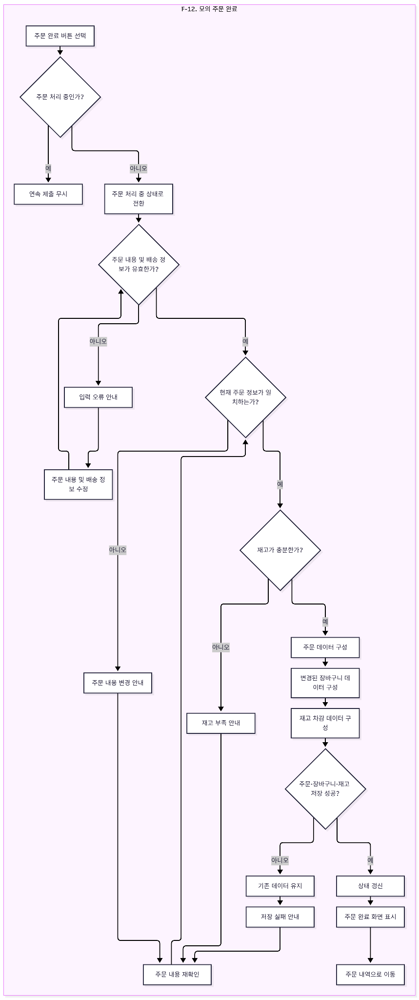
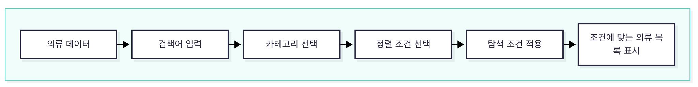

# 02 기능 명세서

> 기능 번호(`F-00`)는 01 요구 분석서의 요구사항 번호(`R-00`)와 연결하며, 03 화면 정의 목록서와 11 테스트 체크리스트에서 그대로 사용합니다.

## 2.1. 문서 개요

| 항목 | 내용 |
|---|---|
| 프로젝트명 | OOTD |
| 서비스 | 의류를 판매하는 의류 구매 쇼핑몰 |
| 기준 문서 | 1단계 프로젝트 주제 및 요구 분석서 |
| 구현 환경 | 리액트, mock 데이터, localStorage |
| 주문 범위 | 배송 정보 입력과 주문 내역 저장까지 진행하는 모의 주문 |

로그인, 관리자 인증, 백엔드, 실제 결제·환불·배송, 외부 알림 발송, 사이즈 외 의류 옵션, 쿠폰·적립금, 리뷰·문의는 구현 범위에서 제외한다. 관리자 기능과 재고는 추가 기능으로 구현한다.

## 2.2. 공통 동작 규칙

| 구분 | 규칙 |
|---|---|
| 상품 구분 | 의류 ID로 구분한다. 상품명이 같아도 ID가 다르면 다른 상품이다. 같은 의류의 다른 색상은 별도 상품으로 등록한다. |
| 의류 ID | 의류 ID는 등록 순서대로 커지는 정수이다. 새 의류는 저장된 ‘다음 ID’ 값을 사용하고 그 값을 1 늘린다. 삭제된 의류의 ID는 다시 사용하지 않는다. |
| 사이즈 | 의류마다 선택 가능한 사이즈 목록이 있으며, 장바구니에 담으려면 사이즈 하나를 반드시 선택한다. |
| 장바구니 항목 구분 | 의류 ID와 사이즈의 조합으로 구분한다. 같은 의류라도 사이즈가 다르면 다른 항목이다. |
| 수량 | 한 항목의 수량은 1~99의 정수이다. 소수, 빈 값, 문자, 범위 밖의 값은 확정하지 않는다. |
| 중복 담기 | 같은 의류 ID·같은 사이즈가 이미 장바구니에 있으면 수량을 합산한다. 합산 결과가 99를 넘으면 추가하지 않고 기존 값을 유지한다. |
| 정가 | mock 데이터 또는 관리자가 저장한 값의 0 이상 정수 원화 가격을 사용한다. |
| 할인율 | 0~90의 정수(%)이다. 할인 기능(F-26)을 구현했으므로 관리자가 의류마다 값을 정한다. |
| 판매 가격 | 정가 × (100 − 할인율) ÷ 100. 원 단위 미만은 버린다. 할인율이 0이면 정가와 같다. |
| 항목별 금액 | 판매 가격 × 수량 |
| 주문 상품 금액 | 주문 대상 항목별 금액의 합계 |
| 최종 금액 | 주문 상품 금액 + 배송비. 쿠폰과 적립금은 구현하지 않는다. |
| 배송비 | 배송비 기능을 구현하지 않으므로 항상 0원이다. |
| 주문 대상 | 선택 주문을 구현하지 않으므로 항상 장바구니 전체를 주문한다. |
| 재고 | 사이즈별 재고(0 이상의 정수)를 관리한다. 1~3개는 ‘재고 부족’, 0개는 ‘재고 없음’으로 본다. |
| 재고 한도 | 한 항목의 수량은 해당 사이즈 재고를 넘을 수 없다. 수량 한도는 99와 재고 중 작은 값이다. |
| 재입고 일시 | 재입고(F-25), 관리자 수정(F-24), 주문 취소(F-18) 등 어떤 경로든 사이즈 재고가 0에서 1 이상이 되면 해당 사이즈의 재입고 일시를 기록한다. |
| 구매 불가 항목 | 장바구니 항목의 의류가 삭제되었거나, 해당 사이즈가 의류의 사이즈 목록에서 없어졌으면 구매 불가 항목으로 본다. |
| 저장 | 장바구니·주문 내역과 추가 구현한 좋아요 목록·최근 검색어·주문 상태·재입고 알림 신청, 관리자가 변경한 의류 정보·할인율·재고는 변경 후 localStorage에 저장한다. |
| 일시적인 상태 | 검색 조건, 브랜드·종류 필터, 정렬, 페이지 번호, 선택 중인 사이즈·수량, 입력 중인 배송 정보, 사이드바·팝업 열림 여부는 새로고침 후 유지하지 않아도 된다. |
| 주문 내용 보존 | 완료된 주문은 주문 시점의 상품명·브랜드·사이즈·정가·할인율·판매 가격·수량·금액을 보관한다. 이후 의류 정보·가격·할인율이 바뀌거나 의류가 삭제되어도 과거 주문 금액을 다시 계산하지 않는다. |
| 주문 상태 | 주문 완료, 배송중, 배송 완료, 취소(F-18)를 둔다. 새 주문은 ‘주문 완료’로 저장한다. 실제 배송 기능은 없으므로 배송중·배송 완료는 화면 표시용 값이다. |
| 저장 실패 | 저장되지 않은 변경을 성공으로 안내하지 않는다. 기존 저장 데이터와 기존 확정 상태를 유지하고 재시도를 안내한다. |

## 2.3. 전체 기능 목록

### 필수 기능

| 기능 번호 | 기능명 | 설명 | 관련 요구사항 |
|---|---|---|---|
| F-01 | 의류 목록 조회 | 의류 데이터를 카드 목록으로 표시한다. | R-02 |
| F-02 | 의류 검색 | 상품명·의류 종류·브랜드에 검색어가 포함된 의류를 찾는다. | R-01 |
| F-03 | 브랜드·종류 필터 | 선택한 브랜드와 의류 종류의 의류를 표시한다. | R-02 |
| F-04 | 의류 상세 조회 | 선택한 의류의 정보를 표시한다. | R-03 |
| F-05 | 사이즈·구매 수량 선택 | 상세 화면에서 담을 사이즈와 수량, 금액을 확인한다. | R-04 |
| F-06 | 장바구니 담기 | 의류를 사이즈별로 추가하거나 기존 수량에 합산한다. | R-04 |
| F-07 | 장바구니 조회 | 담긴 의류, 사이즈, 수량, 금액을 표시한다. | R-04, R-05 |
| F-08 | 장바구니 수량 변경 | 수량과 금액을 변경하고 저장한다. | R-04 |
| F-09 | 장바구니 삭제 | 개별 항목을 삭제하고 저장한다. | R-04 |
| F-10 | 주문서 확인 | 주문 대상 의류와 최종 금액을 표시한다. | R-05 |
| F-11 | 배송 정보 입력·검사 | 수령인 이름, 연락처, 주소를 입력하고 필수 값을 검사한다. | R-05 |
| F-12 | 모의 주문 완료 | 주문을 저장하고 주문한 항목을 장바구니에서 제거한다. | R-05, R-06 |
| F-13 | 주문 내역 조회 | 저장된 주문과 주문별 의류를 확인한다. | R-06 |
| F-14 | 저장 데이터 복원 | 같은 브라우저에서 저장한 데이터를 불러온다. | R-07 |
| F-15 | 공통 메뉴·상태 안내 | 화면 이동, 장바구니 수량, 빈 상태를 안내한다. | 업무 범위·사용성 |

### 추가 기능

| 기능 번호 | 기능명 | 설명 | 관련 요구사항 |
|---|---|---|---|
| F-16 | 좋아요(찜) 관리 | 좋아요 등록·해제·조회와 저장을 처리한다. | R-08 |
| F-17 | 의류 정렬 | 드롭다운 메뉴에서 등록순·최신순·가격순·할인율순으로 정렬한다. | R-09 |
| F-18 | 모의 주문 취소 | 주문 상태를 취소로 변경하고 재고를 되돌린다. | R-10 |
| F-19 | 페이지네이션 | 의류 목록을 한 페이지 12개씩 나누어 표시한다. | R-11 |
| F-20 | 최근 검색어 | 최근 검색어를 최대 10개 저장·재검색·삭제한다. | R-12 |
| F-21 | 사이드바 필터 | 브랜드·종류 필터를 목록 옆 사이드바 형태로 제공한다. | R-13 |
| F-22 | 탐색 조건 결합·초기화 | 검색·필터·정렬을 함께 적용하고 초기화한다. | 탐색 기능 확장 |
| F-23 | 관리자 의류 목록·등록 | 관리자 페이지에서 의류 목록을 보고 새 의류를 등록한다. | R-14 |
| F-24 | 관리자 의류 수정·삭제 | 등록된 의류 정보를 수정하거나 삭제한다. | R-14 |
| F-25 | 재입고 | 사이즈별 재고를 입고 수량만큼 늘린다. | R-14 |
| F-26 | 할인율 부여·할인 가격 표시 | 의류에 할인율을 부여하고 할인 전·후 가격을 표시한다. | R-15 |
| F-27 | 재고 상태 표시·구매 제한 | 사이즈별 재고 부족·재고 없음을 표시하고 재고를 넘는 구매를 막는다. | R-16 |
| F-28 | 재입고 알림 신청 | 재고 없음 사이즈에 재입고 알림을 신청한다. | R-16 |
| F-29 | 재입고 알림 팝업 | 신청한 사이즈가 재입고되면 5초 뒤 팝업으로 알린다. | R-16 |

추가 기능은 F-01~F-15가 연결된 뒤 확장한다. 관리자 기능(F-23~F-26)과 재고·알림(F-27~F-29)은 가장 나중에 진행한다. F-18의 재고 복원은 F-27을 구현했을 때 적용한다. F-25와 F-28은 F-27을, F-29는 F-25와 F-28을 전제로 한다. F-21은 F-03의 필터를 사이드바 형태로 보여 주는 기능이다. **F-01~F-29를 모두 구현했으므로 ‘미구현’으로 표시한 기능은 없다.**

가이드 샘플의 선택 주문, 배송비 계산, 연락처 형식 검사, 주문 상세 조회, 모바일 화면 대응은 구현하지 않는다. 따라서 주문 대상은 장바구니 전체, 배송비는 0원이며, 연락처는 필수 입력만 검사한다.

## 2.4. 필수 기능 상세

### F-01. 의류 목록 조회

* 실행 조건: 의류 목록을 연다.
* 입력·실행: 최초 접속 또는 공통 메뉴의 의류 목록 선택.
* 처리: 의류 데이터를 등록순으로 표시한다.
* 결과·저장: 각 의류의 사진, 브랜드, 상품명, 판매 가격을 표시한다. 할인 중인 의류는 F-26에 따라 표시한다. 목록 조회는 저장 데이터를 변경하지 않는다.
* 예외 처리: 의류가 없으면 ‘등록된 제품이 없습니다’를 표시한다. 데이터를 읽지 못한 경우에는 데이터가 없는 경우와 구분하여 불러오기 실패를 안내한다.

### F-02. 의류 검색

* 실행 조건: 의류 목록과 검색 입력창을 사용할 수 있다.
* 입력·실행: 검색어를 입력하고 검색 버튼 또는 Enter를 누른다.
* 처리: 검색어 앞뒤 공백을 제거한다. 상품명, 의류 종류, 브랜드 중 하나에 검색어가 포함되면 결과에 포함하며, 영문 대소문자는 구분하지 않는다.
* 결과·저장: 일치하는 의류와 결과 개수를 표시한다. 빈 검색어는 검색 제한을 해제한다. 검색 조건은 localStorage에 저장하지 않는다. 검색어는 최근 검색어에 저장한다(F-20).
* 예외 처리: 일치하는 의류가 없으면 ‘검색 결과가 없습니다’를 표시한다.
* 조건 유지: F-22를 구현했으므로 검색을 실행해도 브랜드·계절·종류와 정렬은 그대로 두고 페이지만 1로 돌아간다.

### F-03. 브랜드·종류 필터

* 실행 조건: 성별 의류 목록(MEN·WOMEN·UNISEX)에서 브랜드와 의류 종류를 선택할 수 있다. 전체 의류 목록(CLOTHES)은 성별 탭으로 고르는 화면이라 필터를 제공하지 않는다.
* 입력·실행: 브랜드 하나 또는 ‘전체’, 의류 종류(예: 상의, 하의, 아우터) 하나 또는 ‘전체’를 선택한다. 브랜드와 종류 목록은 05 데이터 정의서에서 정한다.
* 처리: 선택한 브랜드와 종류를 모두 만족하는 의류만 표시한다. ‘전체’는 해당 조건의 제한을 해제한다.
* 결과·저장: 선택한 브랜드·종류와 의류 목록을 표시한다. 기초 데이터와 저장 데이터는 변경하지 않는다.
* 예외 처리: 조건에 맞는 의류가 없으면 빈 결과 안내를 표시한다.
* 조건 유지: F-22를 구현했으므로 필터를 바꿔도 검색어와 정렬은 그대로 두고 페이지만 1로 돌아간다.

### F-04. 의류 상세 조회

* 실행 조건: 목록에서 의류를 선택하거나 의류 상세에 접근한다.
* 입력·실행: 의류 ID.
* 처리: 해당 ID의 의류 정보를 찾는다.
* 결과·저장: 사진, 브랜드, 상품명, 판매 가격, 의류 종류, 착용 계절, 사이즈, 권장 성별, 설명을 표시한다. 할인 중인 의류는 F-26, 사이즈별 재고 상태는 F-27에 따라 표시한다. 다른 의류를 열면 사이즈는 선택 안 함, 구매 수량은 1로 시작한다.
* 예외 처리: ID와 일치하는 의류가 없으면 ‘의류를 찾을 수 없습니다’를 표시하고, 구매 조작 대신 의류 목록으로 이동하는 동작을 제공한다.

### F-05. 사이즈·구매 수량 선택

* 실행 조건: 유효한 의류 상세를 보고 있다.
* 입력·실행: 사이즈 버튼 선택, 수량 증감 버튼 또는 수량 입력.
* 처리: 사이즈는 하나만 선택하며, 다른 사이즈를 누르면 선택이 바뀐다. 수량은 1~99의 정수만 확정한다. 입력창은 Enter 또는 입력창에서 벗어날 때 검사한다. 재고 없음 사이즈는 선택할 수 없고, 수량 한도는 선택한 사이즈의 재고를 따른다(F-27).
* 결과·저장: 선택 사이즈, 선택 수량, ‘판매 가격 × 수량’을 표시한다. 이 단계에서는 장바구니를 변경하지 않는다.
* 예외 처리: 잘못된 수량은 마지막 유효 수량으로 복원하고 범위를 안내한다. 1에서 감소, 한도에서 증가하는 동작은 막는다.

### F-06. 장바구니 담기

* 실행 조건: 유효한 의류, 선택한 사이즈, 확정된 구매 수량이 있다.
* 입력·실행: 장바구니 담기 버튼 선택.
* 처리: 의류 ID와 사이즈를 비교하여 새 항목을 추가하거나 기존 수량에 합산한다. 합산 후 수량도 검사한다.
* 결과·저장: 변경한 장바구니를 저장하고 ‘장바구니에 담았습니다’를 표시한다. 상세 화면에 머무르며 장바구니로 이동할 수 있는 동작을 제공한다. 공통 장바구니 수량도 갱신한다.
* 예외 처리: 사이즈를 선택하지 않았으면 담지 않고 ‘사이즈를 선택하세요’를 표시한다. 합산 결과가 99를 넘으면 추가하지 않고 기존 수량을 유지한다. 합산 결과가 재고를 넘을 때도 추가하지 않고 추가로 담을 수 있는 수량을 안내한다(F-27). 저장 실패 시 담기 성공으로 안내하지 않는다.

예: M 사이즈 1개가 담긴 상태에서 M 사이즈 2개를 담으면 한 항목의 수량이 3개가 된다. 같은 의류의 L 사이즈 1개를 담으면 별도 항목으로 추가된다. M 사이즈 98개가 담긴 상태에서 2개를 담으면 기존 98개를 유지한다. 재고가 3개인 사이즈를 2개 담은 상태에서 2개를 더 담으면 기존 2개를 유지하고 ‘추가로 담을 수 있는 수량은 1개입니다(재고 3개)’를 안내한다.

### F-07. 장바구니 조회

* 실행 조건: 장바구니를 연다.
* 입력·실행: 공통 메뉴 또는 담기 안내에서 장바구니 선택.
* 처리: 담긴 항목과 현재 의류 정보를 연결하여 판매 가격과 금액을 계산한다.
* 결과·저장: 사진, 브랜드, 상품명, 사이즈, 판매 가격, 수량, 항목별 금액, 주문 상품 금액을 표시한다. 조회만으로 저장 데이터를 변경하지 않는다.
* 예외 처리: 비어 있으면 ‘장바구니가 비어 있습니다’와 의류 목록 이동 동작을 제공하고, 주문 동작은 사용할 수 없게 한다. 구매 불가 항목(삭제된 의류, 없어진 사이즈)은 ‘구매 불가’로 표시하고 삭제할 수 있게 하며, 해당 항목이 있으면 주문을 막는다. 수량이 현재 재고보다 많은 항목은 ‘재고 부족(남은 수량 N개)’으로 표시하고, 수량을 줄이거나 삭제하기 전까지 주문을 막는다.

### F-08. 장바구니 수량 변경

* 실행 조건: 장바구니에 해당 항목이 있다.
* 입력·실행: 수량 증감 또는 수량 입력 확정.
* 처리: F-05의 수량 검사 규칙을 적용한다.
* 결과·저장: 유효한 수량을 저장하고 항목별 금액, 주문 상품 금액, 공통 장바구니 수량을 갱신한다.
* 예외 처리: 잘못된 값 또는 저장 실패 시 기존 확정 수량을 유지하고 이유를 안내한다.

### F-09. 장바구니 삭제

* 실행 조건: 삭제할 항목이 있다.
* 입력·실행: 해당 항목의 삭제 버튼 선택.
* 처리: 해당 의류 ID·사이즈의 항목을 제거한다. 개별 삭제는 별도 확인 없이 실행한다.
* 결과·저장: 변경 내용을 저장하고 수량과 금액을 갱신한다. 마지막 항목을 삭제하면 빈 장바구니 안내를 표시한다.
* 예외 처리: 저장 실패 시 기존 항목을 유지한다. 이미 삭제된 항목의 반복 삭제는 다른 항목에 영향을 주지 않는다.

### F-10. 주문서 확인

* 실행 조건: 장바구니에 한 항목 이상이 있고, 모든 항목이 구매 가능한 의류와 유효한 수량이다.
* 입력·실행: 장바구니의 주문 버튼 선택.
* 처리: 장바구니 전체를 주문 대상으로 정하고 금액을 계산한다.
* 결과·저장: 주문할 의류, 사이즈, 판매 가격, 수량, 항목별 금액, 배송비(0원), 최종 금액을 표시한다. 주문서를 여는 것만으로 주문 내역을 저장하거나 장바구니를 비우지 않는다.
* 예외 처리: 대상이 없거나 유효하지 않으면 주문을 진행하지 않고 장바구니 확인을 안내한다. 주문서 새로고침이나 직접 접근으로 주문 대상을 확인할 수 없으면 장바구니에서 다시 시작하도록 안내한다.

### F-11. 배송 정보 입력·검사

* 실행 조건: 유효한 주문서가 표시되어 있다.
* 입력·실행: 수령인 이름, 연락처, 주소 입력 후 주문 완료 버튼 선택.
* 처리: 각 값의 앞뒤 공백을 제거하고 빈 값인지 검사한다. 주소는 직접 입력하며 외부 주소 검색 서비스를 사용하지 않는다.
* 결과·저장: 필수 항목이 유효하면 F-12로 이어진다. 입력 중인 배송 정보는 별도로 저장하지 않으며 완료된 주문에 포함한다.
* 예외 처리: 빈 값이나 공백만 있는 항목에는 ‘수령인 이름을 입력하세요’처럼 항목별 오류를 표시하고 주문을 막는다. 입력한 다른 값은 유지한다. 연락처 형식은 검사하지 않는다.

### F-12. 모의 주문 완료

* 실행 조건: 유효한 주문 대상과 배송 정보가 있으며 주문 처리 중이 아니다.
* 입력·실행: 주문 완료 버튼 선택.
* 처리: 다음 순서로 처리한다.
  1. 처리 중 상태로 전환하여 연속 제출을 막는다.
  2. 주문 대상의 의류·사이즈·수량·금액이 현재 내용과 일치하는지 다시 확인한다. 재고도 다시 확인한다(F-27). 달라졌다면 저장하지 않고 주문 내용을 다시 확인하게 한다.
  3. 주문 ID, 주문 일시, 주문 시점 의류 정보(상품명·브랜드·사이즈·정가·할인율·판매 가격)·수량·금액, 배송 정보, ‘주문 완료’ 상태를 구성한다.
  4. 기존 주문 내역에 새 주문을 추가하고, 주문한 항목을 제거한 장바구니를 구성한다. 주문한 사이즈의 재고를 주문 수량만큼 줄인 의류 데이터도 구성한다(F-27).
  5. 주문 내역, 변경된 장바구니(와 재고)를 함께 반영한 데이터를 저장한다.
* 결과·저장: 저장 성공 후 상태와 화면을 갱신하고 주문 ID와 완료 안내를 표시한다. 주문 내역으로 이동할 수 있게 한다.
* 예외 처리: 입력 오류, 주문 내용 변경, 재고 부족, 저장 실패 시 주문 완료로 처리하지 않는다. 저장 실패 시 기존 주문·장바구니·재고를 유지하고 재시도를 허용한다. 성공한 동일 제출은 반복 실행되지 않게 한다.

주문 저장, 장바구니 정리, 재고 차감이 따로 성공하지 않도록 한 번의 저장으로 반영할 수 있는 구조를 5단계에서 설계한다. 모의 주문은 실제 결제를 요청하지 않는다.

### F-13. 주문 내역 조회

* 실행 조건: 주문 내역을 연다.
* 입력·실행: 공통 메뉴 또는 주문 완료 안내에서 주문 내역 선택.
* 처리: 저장된 주문을 주문 일시가 최근인 순서로 표시한다.
* 결과·저장: 주문 ID, 일시, 상태, 주문 의류(상품명·사이즈·판매 가격·수량·항목별 금액), 배송비, 최종 금액을 주문별로 표시한다. 주문 상세 화면 없이 주문 내역에서 각 주문의 의류를 확인할 수 있어야 한다.
* 예외 처리: 주문이 없으면 ‘주문 내역이 없습니다’를 표시한다. 의류 정보가 변경되거나 삭제되어도 주문 시점에 저장한 내용으로 표시한다.

### F-14. 저장 데이터 복원

* 실행 조건: 사이트 시작 또는 새로고침.
* 입력·실행: 같은 사이트의 localStorage 읽기.
* 처리: 저장 내용을 읽어 JSON 변환과 데이터 구조 검사를 거친 후 리액트 상태를 초기화한다. 초기화 전에 빈 값으로 기존 데이터를 덮어쓰지 않는다.
* 결과·저장: 저장된 장바구니와 주문 내역을 복원한다. 좋아요 목록, 최근 검색어, 재입고 알림 신청, 관리자가 변경한 의류 데이터도 함께 복원한다. 저장 데이터가 처음부터 없으면 빈 상태(의류 데이터는 mock 데이터)로 시작한다.
* 예외 처리: 읽기·변환·구조 검사 실패 시 자동으로 원본을 지우지 않고 실패와 초기화 선택을 안내한다. 이 상태에서는 저장이 필요한 동작을 막고, 사용자가 초기화를 선택하고 확인한 뒤에만 초기 데이터를 저장한다. 초기화 저장도 실패하면 성공으로 안내하지 않는다.

### F-15. 공통 메뉴·상태 안내

* 실행 조건: 서비스 화면을 사용한다.
* 입력·실행: HOME · CLOTHES · LISTS · ORDERS 메뉴와 장바구니 아이콘 선택. 로고 오른쪽의 ADMIN 버튼으로 관리자 화면에 들어간다. 좋아요 목록과 재입고 알림 목록은 LISTS(S-11) 아래에 둔다.
* 처리: 선택한 화면으로 이동하고 장바구니 전체 수량을 표시한다. 수량 표시는 항목 수가 아니라 담긴 수량의 합이다.
* 결과·저장: 두 항목이 각각 2개·3개이면 ‘5’를 표시한다. 현재 화면의 메뉴를 구분하여 표시한다. 빈 목록과 오류는 해당 기능의 안내를 표시한다. 메뉴 이동 자체는 저장 데이터를 변경하지 않는다.
* 예외 처리: 빈 장바구니에서는 수량을 표시하지 않으며, 없는 데이터를 읽으려다 화면이 중단되지 않게 한다. 정의되지 않은 주소로 접근하면 ‘페이지를 찾을 수 없습니다’를 표시한다.

## 2.5. 추가 기능 상세

추가 기능도 구현하기로 했다면 아래 규칙까지 구현·검증한다. 기본 기능과 동작이 달라지는 부분은 함께 적용한다.

### F-16. 좋아요(찜) 관리

* 실행 조건: 의류 목록·상세 또는 좋아요 목록을 보고 있다.
* 입력·실행: 좋아요 버튼 선택 또는 좋아요 메뉴 선택.
* 처리: 의류 ID 기준으로 미등록이면 등록하고, 등록된 경우 해제한다. 중복 ID는 만들지 않는다. 좋아요는 사이즈와 관계없이 의류 단위로 등록한다.
* 결과·저장: 좋아요 목록을 저장하고 관련 화면의 버튼 표시를 갱신한다. 좋아요 목록에서 상세로 이동할 수 있다. 등록한 순서로 표시한다.
* 예외 처리: 목록이 비어 있으면 안내한다. 의류 데이터에 없는 의류(삭제된 의류)는 ‘정보 없음’과 해제 동작을 제공한다. 저장 실패 시 기존 좋아요 상태를 유지한다.

### F-17. 의류 정렬

* 실행 조건: 의류 목록을 보고 있다.
* 입력·실행: 정렬 드롭다운 메뉴에서 등록순, 최신순, 가격순, 할인율순 중 선택. 기본값은 등록순이다. 단, 전체 의류 목록(CLOTHES)은 정렬을 고르기 전까지 무작위 순서로 표시하며, 화면에 들어올 때마다 새로 섞는다. 드롭다운은 의류 목록의 검색(돋보기) 오른쪽 햄버거 버튼을 누르면 펼쳐진다.
* 처리: 현재 조회 결과에 정렬을 적용한다.
  * 등록순: 먼저 등록된 의류부터(의류 ID 오름차순).
  * 최신순: 나중에 등록된 의류부터(의류 ID 내림차순).
  * 가격순: 판매 가격(할인 적용 가격)이 낮은 의류부터.
  * 할인율순: 할인율이 높은 의류부터.
  * 가격순·할인율순에서 같은 값은 의류 ID 오름차순으로 정한다.
* 결과·저장: 정렬된 목록을 표시하고 페이지네이션이 있다면 1페이지로 이동한다. 원본 배열과 저장 데이터는 변경하지 않는다.
* 예외 처리: 결과가 없으면 빈 결과 안내를 유지한다.

### F-18. 모의 주문 취소

* 실행 조건: 주문 내역에서 상태가 ‘주문 완료’인 주문을 보고 있다.
* 입력·실행: 주문 취소 버튼 선택 후 ‘주문을 취소하시겠습니까?’ 확인 창에서 확인.
* 처리: 주문 전체를 취소한다. 상태를 ‘주문 취소’로 바꾸고 취소 일시를 기록한다. 부분 취소는 제공하지 않는다. 주문 항목의 수량만큼 해당 사이즈 재고를 되돌리며(F-27), 재고가 0에서 1 이상이 되면 재입고 일시를 기록한다. 삭제된 의류나 없어진 사이즈의 항목은 재고를 되돌리지 않는다.
* 결과·저장: 변경한 주문 상태(와 재고)를 함께 저장하고 주문 내역에 반영한다. 취소된 주문에는 취소 버튼을 표시하지 않는다. 주문 기록과 원래 금액은 남기며, 장바구니로 의류를 자동 복원하지 않는다. 실제 환불은 없다.
* 예외 처리: 확인 창에서 취소하면 변경하지 않는다. 이미 취소된 주문은 다시 취소하지 않는다. 저장 실패 시 ‘주문 완료’ 상태와 기존 재고를 유지한다.

### F-19. 페이지네이션

* 실행 조건: 성별(MEN·WOMEN·UNISEX) 의류 목록을 보고 있다. 전체 의류 목록(CLOTHES)은 페이지를 나누지 않고 모든 의류를 한 화면에 표시한다.
* 입력·실행: 페이지 번호, 이전 또는 다음 선택.
* 처리: 현재 검색·필터·정렬까지 반영한 결과를 한 페이지당 12개(가로 4개 × 세로 3줄)로 나눈다.
* 결과·저장: 해당 페이지 의류를 표시하고 현재 페이지 번호를 구분하여 표시한다. 조건이 바뀌면 1페이지로 이동한다. 페이지 번호는 저장하지 않는다.
* 예외 처리: 첫·마지막 페이지에서 범위를 벗어난 이동을 막는다. 결과가 0개면 빈 결과 안내를 표시하고 페이지 버튼을 숨긴다. 결과가 12개 이하이거나 전체 목록(CLOTHES)이면 페이지 버튼을 숨긴다.

### F-20. 최근 검색어

* 실행 조건: 의류 목록의 검색 입력창을 사용할 수 있다.
* 입력·실행: 검색 실행, 최근 검색어 선택, 개별 삭제, 전체 삭제.
* 처리: 검색을 실행하면 앞뒤 공백을 제거한 검색어를 맨 앞에 추가한다. 같은 검색어가 이미 있으면 기존 항목을 지우고 맨 앞으로 옮긴다. 영문 대소문자만 다른 검색어는 같은 검색어로 본다. 10개를 넘으면 가장 오래된 검색어를 지운다.
* 결과·저장: 최근 검색어를 최신순으로 최대 10개 표시하고 저장한다. 최근 검색어를 선택하면 그 검색어로 다시 검색한다(F-02).
* 예외 처리: 빈 검색어는 저장하지 않는다. 저장된 검색어가 없으면 ‘최근 검색어가 없습니다’를 표시한다. 저장 실패 시 기존 목록을 유지한다.

### F-21. 사이드바 필터

* 실행 조건: 성별 의류 목록(MEN·WOMEN·UNISEX)을 보고 있으며 F-03이 구현되어 있다. 전체 의류 목록(CLOTHES)에는 사이드바를 두지 않는다.
* 입력·실행: 사이드바의 브랜드·의류 종류 항목 선택.
* 처리: F-03과 같은 규칙으로 필터를 적용한다. 사이드바에는 선택 가능한 브랜드와 종류 목록을 모두 표시한다. 사이드바에는 계절(봄·여름·가을·겨울·사계절) 필터도 함께 두며, 의류의 착용 계절에 고른 계절이 들어 있으면 표시한다. 사계절 의류는 ‘사계절’을 골랐을 때만 표시한다. 브랜드·계절·종류는 함께 적용된다.
* 결과·저장: 목록 옆 사이드바에 현재 선택한 브랜드·종류를 구분하여 표시하고 목록을 갱신한다. 저장 데이터는 변경하지 않는다.
* 예외 처리: 선택 결과가 없으면 빈 결과 안내를 표시한다.

### F-22. 탐색 조건 결합·초기화

* 실행 조건: 검색·브랜드·계절·종류 필터, 정렬, 페이지네이션을 함께 적용할 수 있다.
* 입력·실행: 검색 실행, 브랜드·종류 변경, 정렬 변경 또는 초기화 선택.
* 처리: 검색 일치 조건과 브랜드·종류 조건을 모두 만족하는 의류를 구한다. 이후 정렬하고 페이지를 나눈다. 검색과 필터를 바꿔도 다른 조건을 유지하며 페이지는 1로 돌아간다.
* 결과·저장: 현재 조건과 결과를 표시한다. 초기화 시 입력 중인 검색어와 적용 검색어를 비우고, 브랜드·종류 전체, 등록순, 1페이지로 변경한다. 저장 데이터는 변경하지 않는다.
* 예외 처리: 조합 결과가 없으면 결과 없음 안내와 초기화 동작을 제공한다.

### F-23. 관리자 의류 목록·등록

* 실행 조건: 관리자 페이지에 접근한다. 로그인 없이 주소로 누구나 접근할 수 있다. 공통 메뉴에는 관리자 메뉴를 표시하지 않는다.
* 입력·실행: 관리자 페이지 진입, 등록 폼에 상품명, 브랜드, 의류 종류, 정가, 착용 계절, 권장 성별, 사이즈별 재고, 사진, 설명 입력 후 등록 버튼 선택. 사진은 준비된 이미지 목록에서 선택한다.
* 처리: 입력값의 앞뒤 공백을 제거하고 검사한다. 공통 규칙에 따라 새 의류 ID를 정하고 등록 일시를 기록한 뒤, 할인율 0으로 의류 데이터에 추가한다.
* 결과·저장: 관리자 목록에 의류 ID, 사진, 상품명, 브랜드, 정가, 할인율, 사이즈별 재고와 수정·삭제 동작을 표시한다. 등록하면 변경한 의류 데이터와 다음 ID 값을 저장하고, 관리자 목록과 사용자 화면에 바로 반영한다. ‘등록했습니다’를 표시한다.
* 예외 처리: 필수 항목이 비어 있거나, 정가·재고가 0 이상의 정수가 아니거나, 사이즈가 하나도 없으면 저장하지 않고 항목별 오류를 표시한다. 저장 실패 시 등록 성공으로 안내하지 않는다.

### F-24. 관리자 의류 수정·삭제

* 실행 조건: 관리자 페이지에서 등록된 의류를 선택한다.
* 입력·실행: 수정 폼에서 값 변경 후 저장 버튼 선택, 또는 삭제 버튼 선택 후 확인 창에서 확인.
* 처리: 수정은 F-23과 같은 검사를 거쳐 같은 ID의 정보를 바꾼다. 의류 ID와 등록 일시는 바꾸지 않는다. 수정으로 사이즈 재고가 0에서 1 이상이 되면 재입고 일시를 기록한다. 삭제는 해당 ID의 의류를 의류 데이터에서 제거한다.
* 결과·저장: 변경한 의류 데이터를 저장하고 사용자 화면에 바로 반영한다. 장바구니·좋아요 목록·재입고 알림 신청은 자동으로 바꾸지 않는다. 삭제된 의류와 없어진 사이즈는 F-07의 ‘구매 불가’, F-16의 ‘정보 없음’, F-29의 규칙에 따라 처리한다. 완료된 주문 내역은 바뀌지 않는다.
* 예외 처리: 입력 오류 시 저장하지 않는다. 삭제 확인을 취소하면 변경하지 않는다. 저장 실패 시 기존 의류 데이터를 유지한다.

### F-25. 재입고

* 실행 조건: 관리자 페이지에서 등록된 의류와 사이즈를 선택할 수 있다.
* 입력·실행: 의류·사이즈 선택, 입고 수량 입력, 입고 버튼 선택.
* 처리: 해당 사이즈 재고에 입고 수량을 더한다. 입고 전 재고가 0이었다면 공통 규칙에 따라 해당 사이즈의 재입고 일시를 기록한다.
* 결과·저장: 변경한 재고와 재입고 일시를 저장하고 표시한다. 재입고 알림 신청이 있으면 F-29의 팝업 대상이 된다.
* 예외 처리: 입고 수량이 1 이상의 정수가 아니면 반영하지 않고 안내한다. 저장 실패 시 기존 재고를 유지한다.

### F-26. 할인율 부여·할인 가격 표시

* 실행 조건: 관리자 페이지에서 등록된 의류를 선택할 수 있다.
* 입력·실행: 의류별 할인율 입력 후 저장 버튼 선택.
* 처리: 할인율을 검사하고 저장한다. 판매 가격은 공통 규칙에 따라 계산한다.
* 결과·저장: 할인율을 저장한다. 사용자 화면(목록·상세·장바구니·주문서)에는 할인율, 할인 전 가격(취소선), 할인 가격을 표시한다. 할인율이 0이면 정가만 표시한다. 장바구니 금액은 바뀐 할인율로 다시 계산하고, 완료된 주문 금액은 바꾸지 않는다.
* 예외 처리: 할인율이 0~90의 정수가 아니면 저장하지 않고 안내한다. 저장 실패 시 기존 할인율을 유지한다.

### F-27. 재고 상태 표시·구매 제한

* 실행 조건: 의류 상세 또는 장바구니를 보고 있다.
* 입력·실행: 의류 상세 진입, 사이즈 선택, 장바구니 조회.
* 처리: 사이즈별 재고로 상태를 판단한다. 재고가 4개 이상이면 정상, 1~3개이면 재고 부족, 0개이면 재고 없음이다.
* 결과·저장: 상세 화면의 사이즈마다 ‘재고 부족(N개 남음)’ 또는 ‘재고 없음’을 표시한다. 재고 없음 사이즈는 선택할 수 없고 재입고 알림 신청 동작(F-28)을 제공한다. 수량 한도와 담기·주문 검사는 공통 규칙의 재고 한도를 따른다.
* 예외 처리: 모든 사이즈가 재고 없음이면 상세 화면에 ‘품절’을 표시하고 담기 버튼을 사용할 수 없게 한다.

### F-28. 재입고 알림 신청

* 실행 조건: 의류 상세에서 재고 없음 사이즈를 보고 있다.
* 입력·실행: 해당 사이즈의 재입고 알림 신청 버튼 선택.
* 처리: 의류 ID, 사이즈, 신청 일시, 알림 표시 여부(미표시)로 신청을 구성한다. 같은 의류·같은 사이즈의 미표시 신청이 있으면 새로 만들지 않는다.
* 결과·저장: 신청을 저장하고 ‘재입고되면 알려 드릴게요’를 표시한다. 버튼을 ‘알림 신청 완료’로 바꾼다.
* 예외 처리: 이미 신청한 사이즈는 신청 버튼 대신 ‘알림 신청 완료’를 표시한다. 저장 실패 시 신청 성공으로 안내하지 않는다.

### F-29. 재입고 알림 팝업

* 실행 조건: 알림 표시 여부가 미표시인 재입고 알림 신청이 있고, 해당 사이즈의 재고가 1개 이상이다.
* 입력·실행: 관리자의 재입고(F-25) 후 사용자가 사이트를 이용한다.
* 처리: 사용자 화면에서 미표시 신청과 현재 재고를 비교하여 재입고된 신청을 찾는다. 팝업 시각은 ‘재입고 일시’와 ‘사이트를 연 시각’ 중 늦은 시각에서 5초 뒤이다. 재입고된 신청이 여러 개면 한 팝업에 모아 표시한다. 관리자 페이지에서는 팝업을 띄우지 않으며, 사용자 화면으로 이동하면 같은 규칙으로 띄운다.
* 결과·저장: 팝업에 재입고된 의류의 사진, 상품명, 사이즈와 상세 화면 이동 동작, 닫기 동작을 표시한다. 팝업을 띄운 신청은 ‘표시함’으로 저장하고 다시 띄우지 않는다.
* 예외 처리: 신청한 의류가 삭제되었거나 신청한 사이즈가 없어졌으면 팝업을 띄우지 않고 해당 신청을 ‘표시함’으로 처리한다. 재입고 알림은 같은 브라우저 안에서만 동작한다. 저장 실패로 ‘표시함’을 기록하지 못하면 다음 접속 때 다시 표시될 수 있음을 허용한다.

## 2.6. 금액 계산 예시

아래 의류와 가격은 기능 확인을 위한 가상 데이터이다. 할인 기능(F-26)을 적용한 경우를 기준으로 하며, 배송비는 항상 0원이다.

| 의류 | 사이즈 | 정가 | 할인율 | 판매 가격 | 수량 | 항목별 금액 |
|---|---|---|---|---|---|---|
| 오버핏 셔츠 | M | 40,000원 | 10% | 36,000원 | 2 | 72,000원 |
| 오버핏 셔츠 | L | 40,000원 | 10% | 36,000원 | 1 | 36,000원 |
| 데님 팬츠 | 30 | 55,000원 | 0% | 55,000원 | 1 | 55,000원 |
| 니트 베스트 | FREE | 25,950원 | 15% | 22,057원 | 1 | 22,057원 |

| 경우 | 주문 상품 금액 | 배송비 | 최종 금액 |
|---|---|---|---|
| 장바구니 전체 주문 | 185,057원 | 0원 | 185,057원 |
| 주문 후 관리자가 오버핏 셔츠 할인율을 20%로 변경 | 완료된 주문은 185,057원 유지 | 0원 | 185,057원 |
| 같은 상태로 새로 담은 오버핏 셔츠 M 1개 | 32,000원 | 0원 | 32,000원 |

니트 베스트의 판매 가격은 25,950 × 85 ÷ 100 = 22,057.5원이며, 원 단위 미만을 버려 22,057원이다. 오버핏 셔츠의 M과 L은 사이즈가 달라 별도 항목이다. 할인율이 0인 의류는 판매 가격이 정가와 같다.

## 2.7. 요구사항 반영 확인

| 요구사항 | 대응 기능 |
|---|---|
| R-01 상품명·종류·브랜드 검색 | F-02 |
| R-02 전체·브랜드별·종류별 목록 | F-01, F-03 |
| R-03 의류 정보 확인 | F-04 |
| R-04 사이즈 선택·장바구니 관리 | F-05~F-09 |
| R-05 모의 주문 | F-07, F-10~F-12 |
| R-06 주문 내역 확인 | F-12, F-13 |
| R-07 데이터 유지 | F-14 및 각 변경 기능의 저장 처리 |
| R-08 좋아요(찜) | F-16 |
| R-09 정렬 | F-17 |
| R-10 주문 취소 | F-18 |
| R-11 페이지네이션 | F-19 |
| R-12 최근 검색어 | F-20 |
| R-13 사이드바 필터 | F-21 |
| R-14 관리자 의류 관리·재입고 | F-23, F-24, F-25 |
| R-15 할인율 부여 | F-26 |
| R-16 재고 상태·재입고 알림 | F-27, F-28, F-29 |

F-15, F-22는 요구 분석서의 공통 사용성과 탐색 기능 확장 범위를 구체화한 기능이다.
