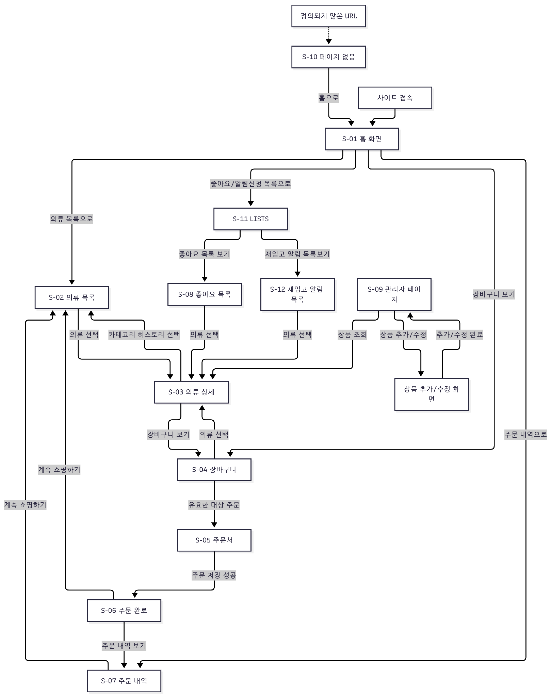

# 03 화면 정의 목록서

> 화면 번호(`S-00`)는 04 와이어프레임, 09 화면별 기능 구현, 11 테스트 체크리스트에서 그대로 사용합니다.
> 기능 번호(`F-00`)는 02 기능 명세서, 요구사항 번호(`R-00`)는 01 요구 분석서를 따릅니다.

## 3.1. 문서 개요

| 항목 | 내용 |
|---|---|
| 프로젝트명 | OOTD |
| 기준 문서 | 1단계 요구 분석서, 2단계 기능 명세서 |
| 라우팅 | React Router의 `BrowserRouter`. 공통 레이아웃(헤더·푸터) 안에서 화면을 바꾼다. |
| URL 규칙 | 영문 소문자와 하이픈을 사용한다. 목록은 복수형(`/products`), 상세는 `/products/:productId`처럼 ID를 경로에 둔다. |
| 화면 범위 | 사용자 화면 10개(S-01~S-08, S-11, S-12)와 관리자 화면 1개(S-09), 페이지 없음 화면 1개(S-10) |
| 화면이 아닌 것 | 알림 팝업, 확인 창, 사이드바, 펼치기 영역은 화면 안의 표시이며 별도 URL을 만들지 않는다. |

## 3.2. 화면 목록

| 화면 번호 | 화면명 | URL | 역할 | 관련 기능 | 구분 |
|---|---|---|---|---|---|
| S-01 | 홈 | `/` | 히어로 표지와 의류 목록 이동을 제공한다. | F-15 | 필수 |
| S-02 | 의류 목록 | `/products` | 의류를 검색·필터·정렬하여 목록으로 본다. | F-01, F-02, F-03, F-17, F-19, F-20, F-21, F-22 | 필수 |
| S-03 | 의류 상세 | `/products/:productId` | 의류 정보를 확인하고 사이즈·수량을 골라 담는다. | F-04, F-05, F-06, F-16, F-27, F-28 | 필수 |
| S-04 | 장바구니 | `/cart` | 담은 항목의 수량·금액을 관리하고 주문을 시작한다. | F-07, F-08, F-09 | 필수 |
| S-05 | 주문서 | `/checkout` | 주문 내용을 확인하고 배송 정보를 입력하여 주문한다. | F-10, F-11, F-12 | 필수 |
| S-06 | 주문 완료 | `/order-complete/:orderId` | 저장된 주문의 완료 결과를 안내한다. | F-12 | 필수 |
| S-07 | 주문 내역 | `/orders` | 완료·취소된 주문과 주문 의류를 확인한다. | F-13, F-18 | 필수 |
| S-08 | 좋아요 목록 | `/wishlist` | 좋아요한 의류를 모아 본다. | F-16 | 추가 |
| S-09 | 관리자 의류 관리 | `/admin` | 의류 등록·수정·삭제, 재입고, 할인율 부여를 처리한다. | F-23, F-24, F-25, F-26 | 추가 |
| S-10 | 페이지 없음 | 정의되지 않은 URL | 잘못된 주소를 안내한다. | F-15 | 필수 |
| S-11 | LISTS | `/lists` | 좋아요 목록과 재입고 알림 목록으로 가는 입구이며, 각 목록에 등록한 의류를 미리 본다. | F-15, F-16, F-28 | 추가 |
| S-12 | 재입고 알림 목록 | `/restock-alerts` | 신청한 재입고 알림과 상태를 확인한다. | F-28, F-29 | 추가 |

관리자 화면(S-09)은 로그인 없이 접근하며, 공통 헤더의 로고 오른쪽 ADMIN 버튼이나 주소로 들어간다. 좋아요 목록(S-08)과 재입고 알림 목록(S-12)은 공통 메뉴의 LISTS(S-11)에 모아 둔다.

## 3.3. 화면별 정의

### S-01. 홈

| 항목 | 정의 |
|---|---|
| URL | `/` |
| 진입 | 사이트 접속, 공통 메뉴의 로고 또는 홈 선택 |
| 필요 데이터 | 없음 (표지 이미지) |
| 주요 표시 | 히어로 표지 이미지, 서비스명 OOTD, 한 줄 소개 |
| 필수 동작 | 의류 목록 이동 |
| 추가 동작 | 없음 |
| 이동 | 의류 보러 가기 → S-02 |
| 화면 상태 | 기본 |

홈은 저장 데이터를 변경하지 않는다. 공통 메뉴로 다른 화면에 바로 갈 수 있으므로 홈에는 진입 동작만 둔다.

### S-02. 의류 목록

| 항목 | 정의 |
|---|---|
| URL | `/products` |
| 진입 | S-01의 의류 보러 가기, 공통 메뉴의 의류 목록, 각 화면의 계속 쇼핑하기 |
| 필요 데이터 | 의류 데이터, 검색어·브랜드·종류·정렬·페이지 조건, 추가 구현한 좋아요 목록·최근 검색어 |
| 주요 표시 | 의류 카드(사진, 브랜드, 상품명, 판매 가격), 결과 개수, 검색 입력창 |
| 필수 동작 | 상품명·종류·브랜드 검색, 브랜드·종류 필터, 의류 상세 이동 |
| 추가 동작 | 정렬 드롭다운, 페이지 이동, 최근 검색어 선택·삭제, 사이드바 필터, 조건 초기화, 좋아요 등록·해제 |
| 이동 | 의류 선택 → S-03 |
| 화면 상태 | 결과 있음, 검색 결과 없음, 등록된 제품 없음, 불러오기 실패 |

검색어·브랜드·계절·종류·정렬은 주소 쿼리(`?gender=women&brand=미쏘&sort=price`)에 담아 새로고침해도 같은 결과를 보여 준다. localStorage에는 저장하지 않는다. 페이지 번호는 주소에 담지 않는 화면 상태이며, 조건이 바뀌면 1로 돌아간다. 조건은 F-22에 따라 함께 적용한다.

브랜드·계절·종류 사이드바(F-03·F-21)는 성별 목록(MEN·WOMEN·UNISEX)에서만 제공하고, 전체 목록(CLOTHES)은 성별 탭으로 고른다. 성별 목록은 한 페이지에 12개(가로 4개 × 세로 3줄)를 표시하고, 전체 목록은 페이지를 나누지 않고 무작위 순서로 모두 표시한다. 최근 검색어와 사이드바 필터는 이 화면 안의 표시이며 별도 URL을 만들지 않는다.

### S-03. 의류 상세

| 항목 | 정의 |
|---|---|
| URL | `/products/:productId` |
| 주소 예시 | `/products/3` |
| 진입 | S-02·S-04·S-08·S-12에서 의류 선택, 관리자 목록(S-09)의 조회, 재입고 알림 팝업의 의류 보기, 주소 직접 접근 |
| 필요 데이터 | URL의 의류 ID, 해당 의류 정보, 선택 사이즈와 수량, 추가 구현한 좋아요 상태·사이즈별 재고·알림 신청 |
| 주요 표시 | 사진, 브랜드, 상품명, 판매 가격, 의류 종류, 착용 계절, 사이즈, 권장 성별, 설명, 선택 수량과 금액 |
| 필수 동작 | 사이즈 선택, 수량 선택, 장바구니 담기, 목록·장바구니 이동 |
| 추가 동작 | 좋아요 등록·해제, 사이즈별 재고 상태 확인, 재입고 알림 신청 |
| 이동 | 목록 보기 → S-02. 장바구니 보기 → S-04 |
| 화면 상태 | 정상 상세, 사이즈 미선택, 수량 오류, 담기 성공·실패, 재고 부족·품절, 없는 의류 |

담기 성공 후 S-03에 머무르며 안내를 표시한다. 장바구니 보기 동작을 선택하면 S-04로 이동한다. 의류 ID가 바뀌면 사이즈는 선택 안 함, 구매 수량은 1로 시작한다.

새로고침해도 URL의 ID로 의류 정보를 다시 찾을 수 있어야 한다. 없는 의류에서는 구매 동작을 막고 ‘의류를 찾을 수 없습니다’와 S-02 이동 동작을 표시한다. 재고 없음 사이즈는 선택할 수 없고(F-27) 같은 자리에서 재입고 알림을 신청한다.

### S-04. 장바구니

| 항목 | 정의 |
|---|---|
| URL | `/cart` |
| 진입 | 공통 장바구니 메뉴, S-03의 장바구니 보기, 주문서의 장바구니 복귀 |
| 필요 데이터 | 복원된 장바구니, 현재 의류 정보, 추가 구현한 사이즈별 재고 |
| 주요 표시 | 사진, 브랜드, 상품명, 사이즈, 판매 가격, 수량, 항목별 금액, 주문 상품 금액 |
| 필수 동작 | 수량 변경, 개별 삭제, 의류 상세 이동, 전체 주문 시작 |
| 추가 동작 | 없음 |
| 이동 | 의류 선택 → S-03. 주문 → S-05. 계속 쇼핑하기 → S-02 |
| 화면 상태 | 항목 있음, 빈 장바구니, 수량 오류, 저장 실패, 구매 불가 항목, 재고 부족 항목 |

선택 주문을 구현하지 않으므로 항상 장바구니 전체가 주문 대상이다. 유효한 주문 대상이 없으면 S-05로 이동하지 않는다.

구매 불가 항목(삭제된 의류, 없어진 사이즈)은 구매 불가로 표시하고 삭제를 허용하며, 해당 항목을 포함한 주문은 막는다. 수량이 재고보다 많은 항목을(F-27) 재고 부족으로 표시하고, 수량을 줄이거나 삭제하기 전까지 주문을 막는다. 화면을 다시 열면 저장된 장바구니를 사용한다.

### S-05. 주문서

| 항목 | 정의 |
|---|---|
| URL | `/checkout` |
| 진입 | S-04에서 유효한 주문 대상을 확인하고 주문 선택 |
| 필요 데이터 | 이번 주문 대상(장바구니 전체), 현재 의류 정보, 입력 중인 배송 정보 |
| 주요 표시 | 주문 의류, 사이즈, 판매 가격, 수량, 항목별 금액, 배송비(0원), 최종 금액, 배송 정보 입력 항목 |
| 필수 동작 | 수령인 이름·연락처·주소 입력, 입력 검사, 모의 주문 실행 |
| 추가 동작 | 주문 시점 재고 확인 |
| 이동 | 저장 성공 → S-06. 장바구니로 돌아가기 → S-04 |
| 화면 상태 | 정상 주문서, 필수 입력 오류, 주문 내용 변경, 재고 부족, 처리 중, 저장 실패, 주문 대상 없음 |

주문서에 들어왔다는 이유로 주문 내역을 생성하거나 장바구니를 비우지 않는다. F-12의 저장이 성공해야 완료 화면으로 이동한다. 입력 오류나 저장 실패 시 S-05에 머무르며 안내한다.

입력 중인 배송 정보는 일시적인 상태로 취급한다. 새로고침이나 직접 접근으로 주문 대상을 확인할 수 없거나 장바구니가 비어 있으면 ‘장바구니에서 주문할 의류를 확인해 주세요’와 S-04 이동 동작을 표시한다.

### S-06. 주문 완료

| 항목 | 정의 |
|---|---|
| URL | `/order-complete/:orderId` |
| 주소 예시 | `/order-complete/O001` |
| 진입 | S-05에서 주문 저장 성공 후 해당 주문 ID로 이동 |
| 필요 데이터 | URL의 주문 ID와 localStorage에서 복원한 해당 주문 |
| 주요 표시 | 주문 완료 안내, 주문 ID, 주문 일시, 최종 금액 |
| 동작 | 주문 내역 보기, 계속 쇼핑하기 |
| 이동 | 주문 내역 보기 → S-07. 계속 쇼핑하기 → S-02 |
| 화면 상태 | 저장된 완료 주문, 주문 정보 없음, 추가 구현한 취소 상태 |

S-06은 F-12의 결과를 보여주는 화면이다. 이 URL을 열거나 새로고침하는 동작으로 새 주문을 생성하지 않는다. 저장된 주문을 ID로 찾아 표시하므로, 일시적인 이전 화면 데이터만으로 완료 여부를 판단하지 않는다.

주문 ID가 없거나 저장된 주문과 일치하지 않으면 성공 안내 대신 ‘주문을 찾을 수 없습니다’와 S-07 이동 동작을 표시한다. 취소된 주문을 이 주소로 다시 열면 현재 취소 상태를 안내하고 주문 내역으로 연결한다.

### S-07. 주문 내역

| 항목 | 정의 |
|---|---|
| URL | `/orders` |
| 진입 | 공통 주문 내역 메뉴, S-06의 주문 내역 보기 |
| 필요 데이터 | localStorage에서 복원한 주문 목록, 추가 구현한 사이즈별 재고 |
| 주요 표시 | 주문 ID·일시·상태, 주문별 상품명·사이즈·판매 가격·수량·항목별 금액, 배송비, 최종 금액 |
| 필수 동작 | 최근 주문부터 목록과 각 주문에 포함된 의류 확인 |
| 추가 동작 | 주문 취소 확인·실행 |
| 이동 | 계속 쇼핑하기 → S-02 |
| 화면 상태 | 주문 있음, 주문 없음, 취소 확인 중, 주문 취소, 취소 저장 실패, 저장 데이터 읽기 실패 |

주문 상세 화면을 따로 만들지 않으므로 S-07에서 각 주문의 의류와 사이즈·수량·금액을 확인할 수 있어야 한다. 목록 안의 펼치기 UI로 표시해도 되며, 펼치기는 새 화면이나 새 URL이 아니다.

주문 취소는 S-07 안의 확인 창으로 처리하고, 성공하면 같은 화면에서 상태와 취소 일시를 갱신한다. 원래 주문 금액과 의류 정보는 유지한다. 주문 시점에 저장한 정보로 표시하므로 현재 의류 데이터가 없어져도 과거 주문 내역을 표시할 수 있어야 한다.

### S-08. 좋아요 목록 — 추가

| 항목 | 정의 |
|---|---|
| URL | `/wishlist` |
| 진입 | S-11 LISTS의 좋아요 목록 선택 |
| 필요 데이터 | 저장된 좋아요 의류 ID와 현재 의류 정보 |
| 주요 표시 | 좋아요 등록 순서의 의류 목록, 사진, 브랜드, 상품명, 판매 가격 |
| 동작 | 좋아요 해제, 의류 상세 이동 |
| 이동 | 의류 선택 → S-03. 의류 목록 보기 → S-02. 뒤로 → S-11 |
| 화면 상태 | 좋아요 있음, 빈 목록, 정보가 없는 의류, 저장 실패 |

좋아요 해제는 S-08 안에서 처리하고 저장 성공 후 목록을 갱신한다. 의류 데이터에 없는 항목은 ‘정보 없음’으로 표시하고 상세 이동 대신 해제만 제공한다.

### S-09. 관리자 의류 관리 — 추가

| 항목 | 정의 |
|---|---|
| URL | `/admin` |
| 진입 | 공통 헤더의 로고 오른쪽 ADMIN 버튼, 주소 직접 입력 |
| 필요 데이터 | 의류 데이터, 다음 의류 ID, 등록·수정 입력값, 준비된 이미지 목록 |
| 주요 표시 | 관리자 의류 목록(의류 ID, 사진, 상품명, 브랜드, 정가, 할인율, 사이즈별 재고), 등록·수정 폼, 재입고 입력 |
| 동작 | 의류 등록, 수정, 삭제, 사이즈별 재입고, 할인율 부여 |
| 이동 | 사용자 화면으로 이동 → S-01 또는 S-02 |
| 화면 상태 | 목록 있음, 등록된 제품 없음, 등록·수정 입력 오류, 삭제 확인 중, 저장 실패 |

관리자 로그인과 권한 확인은 구현하지 않으므로 주소를 아는 누구나 접근한다. 등록·수정 폼과 삭제 확인 창은 이 화면 안에서 처리하며 별도 URL을 만들지 않는다.

변경한 의류 데이터는 저장 즉시 사용자 화면에 반영된다. 사진은 준비된 이미지 목록에서 선택하며 파일을 올리지 않는다. 재입고 알림 팝업은 이 화면에서 띄우지 않고, 사용자 화면으로 이동했을 때 표시한다.

### S-10. 페이지 없음

| 항목 | 정의 |
|---|---|
| 적용 경로 | 정의된 어떤 화면에도 일치하지 않는 URL |
| 주소 예시 | `/unknown-page` |
| 진입 | 잘못된 링크 또는 주소 직접 입력 |
| 필요 데이터 | 없음 |
| 주요 표시 | ‘페이지를 찾을 수 없습니다’ 안내 |
| 동작·이동 | 의류 목록으로 → S-02 |
| 저장 | 조회·이동으로 저장 데이터를 변경하지 않는다. |

`/products/없는ID`는 S-03 경로에 해당하므로 그 화면에서 의류 없음 상태를 표시한다. `/order-complete/없는ID`도 S-06에서 주문 없음 상태로 처리한다. URL 구조 자체가 어떤 화면에도 맞지 않는 경우에 S-10을 표시한다.

### S-11. LISTS — 추가

| 항목 | 정의 |
|---|---|
| URL | `/lists` |
| 진입 | 공통 메뉴의 LISTS |
| 필요 데이터 | 좋아요 목록(`ootd_wishlist`), 재입고 알림 신청(`ootd_restock_alerts`), 의류 데이터 |
| 주요 표시 | 좋아요 목록·재입고 알림 목록으로 가는 카드와 한 줄 설명, 등록 개수. 카드 아래 미리 보기에는 등록한 의류를 한 번에 세 개(사진·브랜드·이름·판매 가격)와 쪽 번호(`2 / 3`)를 표시하고, 재입고 알림은 사이즈와 상태를 함께 표시한다 |
| 동작 | 각 목록으로 이동, `‹` `›`로 앞뒤 의류 보기, 의류 이름 선택 시 상세로 이동 |
| 이동 | 좋아요 목록 → S-08. 재입고 알림 목록 → S-12. 의류 이름 → S-03 |
| 화면 상태 | 정상 / 등록한 의류 없음 |

미리 보기는 저장 데이터를 읽기만 하고 바꾸지 않는다. 좋아요 목록은 등록한 순서대로,
재입고 알림 목록은 최근에 신청한 것부터 보여 주며, 한 번에 세 개씩 표시한다.
첫 쪽에서는 `‹`, 마지막 쪽에서는 `›`를 누를 수 없다. 세 자리를 다 채우지 못하면
남는 자리에 로고를 연하게 넣은 빈 카드를 두어 두 목록 카드의 높이를 맞춘다.
등록한 의류가 없으면 빈 카드 세 개와 함께 "좋아요한 의류가 없습니다." /
"신청한 재입고 알림이 없습니다."를 표시한다. 삭제된 의류는 "판매가 종료된 의류"로
표시하고 상세로 이동하지 않는다.

### S-12. 재입고 알림 목록 — 추가

| 항목 | 정의 |
|---|---|
| URL | `/restock-alerts` |
| 진입 | S-11 LISTS의 재입고 알림 목록 선택 |
| 필요 데이터 | 저장된 재입고 알림 신청과 현재 의류 정보·재고 |
| 주요 표시 | 신청한 의류의 사진·상품명·사이즈·신청 일시, 신청 상태 |
| 동작 | 신청 취소, 의류 상세 이동 |
| 이동 | 의류 선택 → S-03. 의류 보러 가기 → S-02. 뒤로 → S-11 |
| 화면 상태 | 신청 있음, 빈 목록, 정보가 없는 의류, 저장 실패 |

신청 상태는 재고와 표시 여부로 정한다. 아직 재고가 없으면 ‘재입고 기다리는 중’, 재고가 들어왔으면 ‘재입고됨’, 팝업으로 알린 뒤에는 ‘알림 받음’으로 표시한다. 알림을 받지 않은 신청만 취소할 수 있다. 의류 데이터에 없는 항목은 ‘판매가 종료된 의류’로 표시한다.

## 3.4. 공통 적용 기능

| 기능 | 적용 화면 | 화면에서 정할 내용 |
|---|---|---|
| F-14 저장 데이터 복원 | 서비스 공통 | 저장 데이터 초기화가 끝나기 전에 빈 상태로 판단하거나 기존 값을 덮어쓰지 않는다. 복원 실패 안내와 확인 후 초기화 동작을 제공한다. |
| F-15 공통 메뉴·상태 안내 | 모든 화면 (S-01~S-12) | 로고와 HOME · CLOTHES · LISTS · ORDERS 메뉴, 장바구니 아이콘을 제공하고, 로고 오른쪽에 관리자 화면으로 가는 ADMIN 버튼을 둔다. 장바구니는 담긴 수량의 합을 표시한다. |
| F-26 할인 가격 표시 | S-02, S-03, S-04, S-05 | 할인율이 있으면 할인율, 할인 전 가격(취소선), 할인 가격을 같은 방식으로 표시한다. |
| F-27 재고 상태 표시 | S-03, S-04, S-05 | 재고 부족·재고 없음 표시와 담기·주문 제한을 같은 기준으로 적용한다. |
| F-29 재입고 알림 팝업 | 사용자 화면 공통 (S-09 제외) | 조건을 만족하면 현재 화면 위에 팝업으로 표시하고, 닫기와 의류 상세 이동을 제공한다. 별도 URL을 만들지 않는다. |

저장 데이터 복원은 별도 페이지로 만들지 않는다. 읽기 실패 시의 초기화 선택과 저장이 필요한 동작 제한은 F-14를 따른다. 데이터가 아직 준비되지 않은 상태와 실제로 비어 있는 상태를 구분한다.

## 3.5. 화면 이동 관계

### 공통 메뉴

| 출발 화면 | 사용자 동작 | 도착 화면 | 조건 |
|---|---|---|---|
| 모든 화면 | 로고 또는 홈 선택 | S-01 `/` | 없음 |
| 모든 화면 | 의류 목록 선택 | S-02 `/products` | 없음 |
| 모든 화면 | 주문 내역 선택 | S-07 `/orders` | 없음 |
| 모든 화면 | 장바구니 선택 | S-04 `/cart` | 없음 |
| 모든 화면 | LISTS 선택 | S-11 `/lists` | 없음 |
| 모든 화면 | ADMIN 버튼 선택 | S-09 `/admin` | 없음 |

좋아요 목록(S-08)과 재입고 알림 목록(S-12)은 공통 메뉴에 따로 두지 않고 LISTS(S-11)에서 들어간다.

### 주요 사용자 동작

| 출발 화면 | 사용자 동작·발생 상황 | 조건 | 도착 또는 결과 |
|---|---|---|---|
| S-01 | 의류 보러 가기 선택 | 없음 | S-02 |
| S-02 | 의류 선택 | 의류 존재 | 해당 ID의 S-03 |
| S-02 | 검색·필터·정렬·페이지 변경 | 해당 기능 구현 | S-02 안에서 결과 변경 |
| S-03 | 장바구니 담기 | 사이즈 선택, 유효한 수량, 재고 이내 | 저장 성공 후 S-03에서 안내 |
| S-03 | 장바구니 담기 | 사이즈 미선택·수량 오류·재고 초과 | 담지 않고 S-03에서 안내 |
| S-03 | 장바구니 보기 | 없음 | S-04 |
| S-03 | 재입고 알림 신청 | F-28 구현, 재고 없음 사이즈 | 저장 성공 후 S-03에서 안내 |
| S-04 | 의류 선택 | 의류 정보 존재 | 해당 ID의 S-03 |
| S-04 | 수량 변경·삭제 | 유효한 동작 | 저장 성공 후 S-04 갱신 |
| S-04 | 주문 선택 | 유효한 주문 대상 있음 | S-05 |
| S-04 | 주문 선택 | 대상 없음·구매 불가·재고 부족 | 이동하지 않고 안내 |
| S-05 | 주문 완료 선택 | 입력 검사와 주문 저장 성공 | 저장된 주문 ID의 S-06 |
| S-05 | 주문 완료 선택 | 입력 오류·재고 부족·저장 실패 | S-05에서 오류 안내 |
| S-05 | 장바구니로 돌아가기 | 없음 | S-04, 주문 생성 없음 |
| S-06 | 주문 내역 보기 | 없음 | S-07 |
| S-06 | 계속 쇼핑하기 | 없음 | S-02 |
| S-07 | 주문 취소 확인 | F-18 구현, 취소 가능, 저장 성공 | S-07에서 취소 상태 표시 |
| S-08 | 의류 선택 | 의류 정보 존재 | 해당 ID의 S-03 |
| S-08 | 좋아요 해제 | 저장 성공 | S-08에서 목록 갱신 |
| S-09 | 의류 등록·수정·삭제·재입고·할인율 저장 | 입력 검사와 저장 성공 | S-09에서 목록 갱신, 사용자 화면에 반영 |
| S-10 | 의류 목록으로 선택 | 없음 | S-02 |
| 사용자 화면 공통 | 재입고 알림 팝업의 의류 보기 | F-29 구현 | 해당 ID의 S-03 |

표의 ‘장바구니로 돌아가기’, ‘목록 보기’는 지정한 화면으로 이동하는 서비스 내부 동작이다. 브라우저 뒤로 가기처럼 방문 이력에 따라 목적지가 달라지는 동작과 구분한다. 브라우저 뒤로 가기로 주문서나 완료 화면을 다시 열어도 주문을 재생성하지 않는다.

## 3.6. 전체 화면 연결 예시

아래 도식은 주요 화면 이동을 요약한다. 모든 화면의 공통 메뉴와 화면 안에서 끝나는 동작은 3.4~3.5절의 표를 기준으로 확인한다. 점선은 잘못된 주소로 들어온 경우이고, 추가 기능으로 만든 화면은 S-08·S-09·S-11·S-12이다.

- 공통 메뉴(로고·HOME·CLOTHES·LISTS·ORDERS·장바구니)는 모든 화면에서 같은 위치에 있으므로 도식에서는 생략했다.
- 화면 안에서 끝나는 동작(검색·필터·정렬·수량 변경·좋아요·주문 취소)은 화면을 옮기지 않으므로 3.5절의 표로 확인한다.

## 3.7. 새로고침·직접 접근 처리

| 접근 대상 | 복원·확인 기준 | 처리 |
|---|---|---|
| S-01 | 없음 | 히어로 표지를 표시한다. |
| S-02 | 의류 데이터 | 목록을 표시한다. 검색·필터·정렬·페이지 조건은 기본값으로 시작해도 된다. |
| S-03 | URL 의류 ID + 의류 데이터 | 해당 의류 상세를 표시하고, 사이즈는 선택 안 함, 수량은 1로 시작한다. |
| S-04 | 저장된 장바구니 + 의류 데이터 | 담긴 항목을 복원하고 현재 판매 가격으로 금액을 계산한다. |
| S-05 | 저장된 장바구니 + 의류 데이터 | 주문 대상을 확인할 수 없거나 비어 있으면 주문을 막고 S-04에서 다시 시작하도록 안내한다. 입력 중이던 배송 정보는 복원하지 않는다. |
| S-06 | URL 주문 ID + 저장된 주문 | 저장된 결과만 표시한다. 새 주문을 만들지 않는다. |
| S-07 | 저장된 주문 목록 | 이전 주문을 최신순으로 표시한다. |
| S-08 | 저장된 좋아요 ID + 의류 데이터 | 좋아요 목록을 복원한다. |
| S-09 | 의류 데이터 + 다음 의류 ID | 관리자 목록을 표시한다. 입력 중이던 등록·수정 값은 복원하지 않는다. |
| S-10 | 화면 경로 일치 여부 | 잘못된 URL 안내와 S-02 이동을 제공한다. |
| S-11 | 저장된 좋아요·재입고 알림 + 의류 데이터 | 두 목록 카드와 미리 보기를 복원한다. 미리 보기 쪽 번호는 1쪽부터 시작한다. |
| S-12 | 저장된 재입고 알림 + 의류 데이터·재고 | 신청 목록과 상태를 복원한다. |

의류 상세는 이전 화면에서 의류 객체를 전달받아야만 열리는 구조로 정의하지 않는다. 주문 완료 화면도 URL의 ID와 저장 데이터로 확인한다. 재입고 알림 팝업은 저장된 알림 신청과 재고로 판단하므로, 새로고침해도 이미 표시한 알림을 다시 띄우지 않는다. 실제 데이터 구조와 복원 방식은 5단계에서 설계한다.

## 3.8. 기능 반영 확인

| 기능 번호 | 반영 화면 또는 영역 |
|---|---|
| F-01~F-03 | S-02 |
| F-04~F-06 | S-03 |
| F-07~F-09 | S-04 |
| F-10 | S-04에서 주문 시작, S-05에서 주문 내용 표시 |
| F-11 | S-05 |
| F-12 | S-05에서 주문 처리, S-06에서 저장된 성공 결과 표시 |
| F-13 | S-07 |
| F-14 | 공통 데이터 초기화·복원 |
| F-15 | 공통 메뉴·수량 표시·상태 안내, S-01, S-10, S-11 |
| F-16 | S-02·S-03에서 좋아요 변경, S-08에서 목록 조회·해제, S-11에서 미리 보기 |
| F-17·F-19~F-22 | S-02 |
| F-18 | S-07 |
| F-23~F-25 | S-09 |
| F-26 | S-09에서 할인율 입력, S-02·S-03·S-04·S-05에서 할인 가격 표시 |
| F-27 | S-03에서 사이즈별 재고 표시, S-04·S-05에서 재고 검사 |
| F-28 | S-03에서 신청, S-12에서 신청 내역 확인·취소, S-11에서 미리 보기 |
| F-29 | S-09을 제외한 사용자 화면 공통, S-12에서 알림 받은 신청 확인 |
